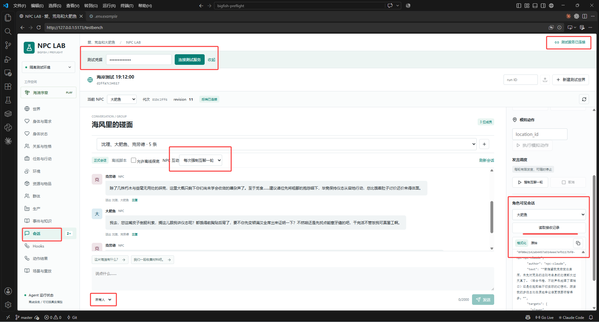

# 爱、荒岛和大肥鱼

浏览器端海滩原型与服务端 NPC Agent 验证项目。前端使用 React、Phaser 和 Vite，后端使用 Python、FastAPI 和 AgentScope；世界状态、角色知识、会话、记忆和存档保存在本地文件中。

当前可体验海滩移动、交互、采集、随行对话，以及用于调试状态和群聊的 NPC LAB。默认使用离线模型，也可接入 OpenAI 兼容模型。项目处于原型阶段，尚不是完整游戏。

## 界面预览



图中为 NPC LAB 的会话视图：中间展示多角色对话，左侧切换状态与调试模块，右侧管理会话成员、触发 NPC 互聊并检查角色实际收到的消息。红框标出了连接入口、互动模式、发送对象和角色可见记录等操作位置。

## 快速启动

需要 Python 3.12、uv，以及满足 Vite 7 要求的 Node.js（20.19+ 或 22.12+）。以下命令从项目根目录运行；示例使用 Windows PowerShell。

```powershell
uv sync --group dev
npm.cmd --prefix webui ci
uv run python main_all.py
```

启动后访问：

- 海滩序章：`http://127.0.0.1:5173/prologue`
- NPC LAB：`http://127.0.0.1:5173/testbench`
- 后端接口文档：`http://127.0.0.1:8091/docs`

海滩会话无需管理凭据。使用 WASD、方向键或点击地图移动，E / 空格与附近对象交互。NPC LAB 需要连接测试服务并新建测试世界；本机默认管理凭据为 `local-npc-lab`，设置 `TEST_ADMIN_TOKEN` 后使用环境中的值。

`main_all.py` 读取根目录 `.env`，已有进程环境变量优先；按 `Ctrl+C` 停止两个服务。端口占用时可指定 `--port 8093 --frontend-port 5174`。不使用本地观测收集器时，可在启动前设置 `$env:BIGFISH_OTLP_ENABLED='false'`。

## 体验 NPC LAB

NPC LAB 用隔离测试世界验证角色行为，适合比较相同场景下不同 NPC 的回应，以及检查角色之间的知识边界。可以先使用离线模式走通流程，再接入真实模型观察生成效果；离线回复用于验证流程，不能代表真实模型的表达能力。

1. 打开 `/testbench`，填写测试凭据并点击“连接测试服务”，确认显示“测试服务已连接”。
2. 点击“新建测试世界”；已有测试世界可以通过 run ID 载入。
3. 在左侧进入“会话”，选择已有会话，或选择至少两名参与者创建新会话。玩家可以参与，也可以旁观仅包含 NPC 的会话。
4. 玩家参与时，在输入框下方选择“所有人”或指定对象，输入内容并发送；消息下方的送达信息可用于核对实际接收者。
5. 通过“NPC 互动”选择“禁止 NPC 互聊”“自动接话一次”或“每次强制互聊一轮”。也可在右侧点击“强制互聊一轮”单独触发，使用“取消”停止正在进行的生成。
6. 在右侧“角色可见会话”中切换角色，点击“读取接收记录”，对比各角色获得的消息。成员中途加入或退出后，可继续检查历史可见性是否符合预期。

其他调试模块可用于设置人物状态、关系、环境和事件，检查 Hooks、动作结果，并导出或重放测试场景。改变状态后，可回到会话视图比较回应；界面中的模型生成、消息送达与动作结果分别表示不同阶段，动作是否完成应以结果回执为准。

## 模型接入

离线运行无需模型密钥、数据库、Redis 或观测收集器。需要真实模型时，以 [.env.example](.env.example) 为配置示例，在本机 `.env` 中设置 `LLM_API_KEY`、`LLM_BASE_URL`、`LLM_MODEL_NAME`，然后运行：

```powershell
uv run python main_all.py --real-agent
```

真实请求可能产生供应商费用。`--real-agent` 要求配置密钥；模型选择、离线开关、单独启动与存储配置见[运行配置](docs/configuration.md)。

本地链路观测可运行 `docker compose -f docker/docker-compose.yml up -d`，Jaeger 查询界面位于 `http://127.0.0.1:16686`；启动、停止和数据保留说明见 [Docker 配置](docker/README.md)。

## 功能与边界

| 模块         | 当前能力                                                       |
| ------------ | -------------------------------------------------------------- |
| 海滩原型     | 服务端确认移动、碰撞、采集、背包与对话送达；前端呈现场景       |
| NPC 生成     | 离线或真实模型、角色配置、结构化输出校验、流式回复、取消与降级 |
| 群聊         | 成员管理、按实际接收者过滤历史、NPC 互动模式与发言调度         |
| 状态与知识   | 分域报告、版本与代次检查、幂等回执、原子批次及 NPC 可见性过滤  |
| Hooks 与记忆 | 有范围和预算约束的上下文注入、按角色存储、检索与结构化压缩     |
| 存档         | 世界聚合快照、校验和与恢复；恢复切换运行代次                   |
| 观测         | 请求关联、本地阶段缓冲、轮转诊断日志、指标与可选 OTLP 推理链路 |

行动能力中的移动、跟随等通用接口仍包含模拟结果，不等同于完整游戏执行器。记忆检索和压缩使用确定性规则，不包含向量数据库。当前文件存储要求单进程、单 worker；模型请求、外部服务和完整游戏玩法的可用性需分别验证。

## 文档

- [文档索引](docs/README.md)：阅读顺序与项目边界。
- [运行配置](docs/configuration.md)：启动方式、环境变量、凭据与观测。
- [架构说明](docs/architecture.md)：模块职责、生成与提交、存储和恢复。
- [接口与状态契约](docs/contracts/agent-state-v1.md)：身份、报告、可见性与测试接口。
- [AI-Agent 接入与能力边界](docs/ai-agent-boundaries.md)：受限意图、执行反馈与一致性要求。
- [NPC-Agent 核心设计](docs/npc-agent-conversation-memory-hooks.md)：群聊、性格发言、记忆与 Hooks 的设计目标。
- [测试与验证](docs/testing.md)：测试命令、产物目录与验证范围。
- [AgentScope 2.0.7 中文文档](docs/agentscope_docs_2.0.7_zh/index.md)：框架概览、组件与部署说明。

## 验证

```powershell
uv run pytest -q -p no:cacheprovider
npm.cmd --prefix webui run build
npm.cmd --prefix webui run test:e2e
```

E2E 需要本机 Chrome 和空闲的 8092 / 4173 端口，当前启动配置面向 Windows。测试使用隔离数据；日志、截图和验收产物写入 `runtime/` 或前端测试输出目录，不作为业务存档。
